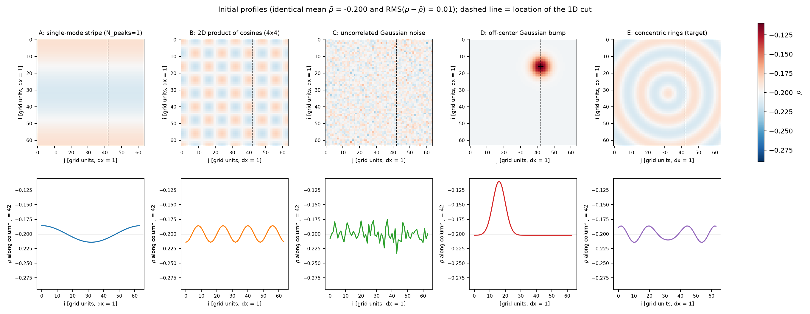
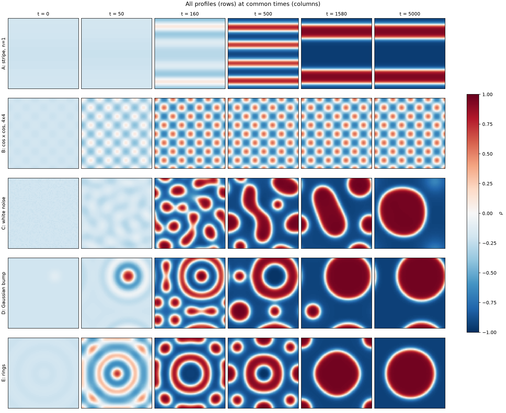
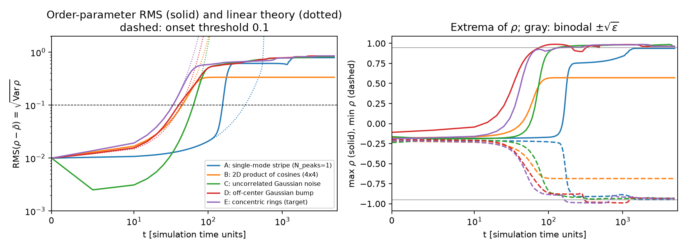
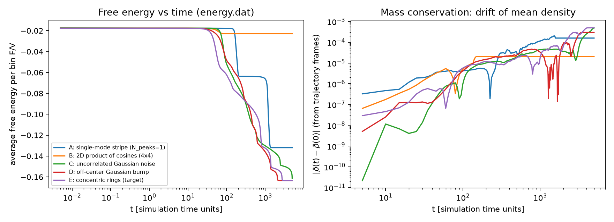
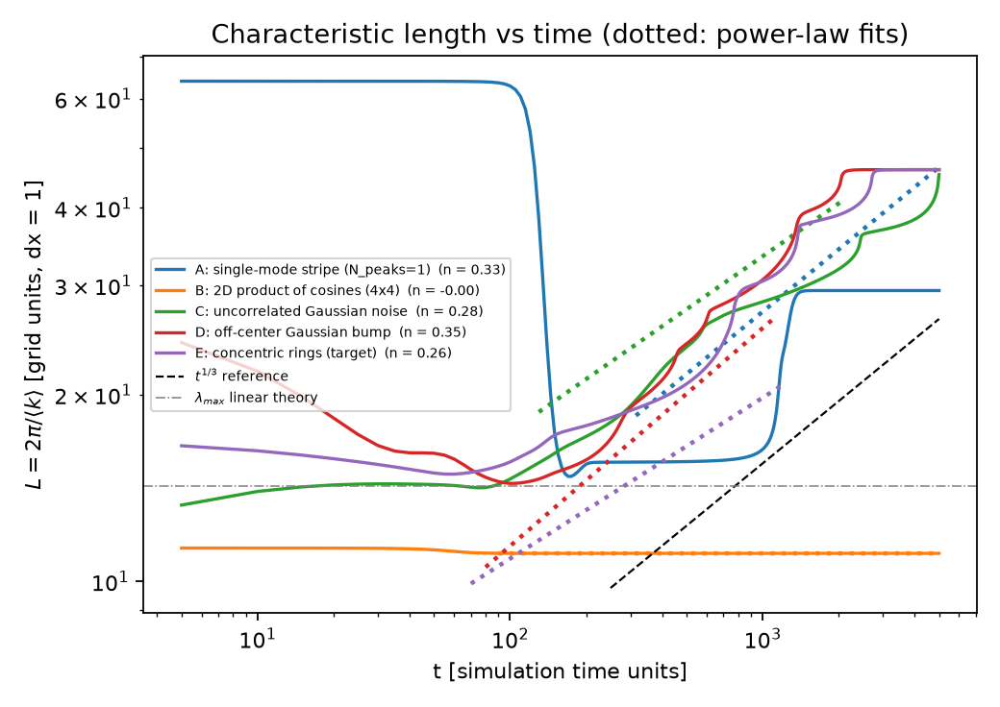
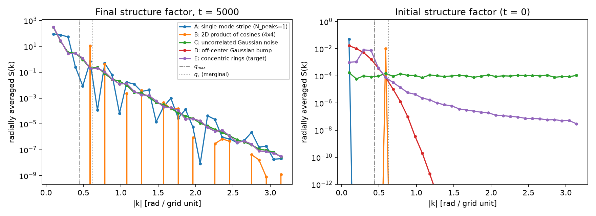
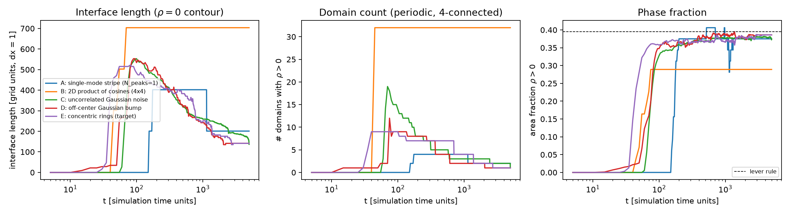

# Effect of the initial perturbation pattern on Cahn-Hilliard evolution

All numbers below come from `results/metrics.json`, `results/metrics_summary.csv` and the runs described in
[README.md](README.md). Code-level facts are documented with line citations in [REPO_NOTES.md](REPO_NOTES.md).

## 1. Objective and model

**Objective.** Five initial conditions share the same mean density and the same perturbation amplitude, and every
other parameter is held fixed. The question is how much of the later evolution (onset, length scale, morphology,
energy decay) is set by the *spatial pattern* of the initial perturbation.

**Model.** This is the repo's Cahn-Hilliard model with the Landau bulk free energy, integrated with explicit Euler
on a periodic 2D grid (`explicit_euler.py` lines 30-45):

$$\partial_t\rho = M\nabla^2\mu,\qquad \mu = f'(\rho) - 2k\,\nabla^2\rho,\qquad f(\rho) = -\tfrac{\epsilon}{2}\rho^2 + \tfrac14\rho^4 ,$$

with the 5-point periodic Laplacian. The factor 2 is `interface_scalar = 2`. With it, \(\mu\) is the exact variational
derivative of the logged energy \(F/V = \langle f(\rho) + k|\nabla\rho|^2\rangle\) (`cahn_hilliard.py` lines 22-41).

| Parameter | Value | Parameter | Value |
|---|---|---|---|
| `model` / `free_energy` / `integrator` | `ch` / `landau` / `euler` | `N`, `dim`, `dx` | 64, 2, 1.0 |
| `epsilon` | 0.9 | `dt` | 0.005 |
| `k`, `interface_scalar`, `M` | 1.0, 2.0, 1.0 | `steps` (final time) | 1,000,000 (t = 5000) |
| `float_type` | `float32` | `print_every` / `print_trajectory_every` | 100 (dt_out = 0.5) / 1000 (dt_out = 5) |
| `seed` | 2026 | mean density, RMS amplitude | -0.2, 0.01 |

Every per-profile TOML is generated from `configs/base.toml` and differs only in `load_from` and `write_path`; this
is asserted in `run_study.py`. The baseline is `Examples/landau/euler_noautodiff.toml`. I kept its \(\epsilon\),
`interface_scalar`, N and Euler integrator. `dt` was raised from 0.001 to 0.005 so that t = 5000 fits in 1M steps.
Float32 replaces float64, as the task requires.

**Why \(\bar\rho = -0.2\).** The spinodal is \(f''(\rho) = -\epsilon + 3\rho^2 < 0\), i.e. \(|\rho| < \sqrt{\epsilon/3} = 0.548\).
The binodal is \(\pm\sqrt{\epsilon} = \pm 0.949\). At \(\bar\rho = -0.2\), \(f'' = -0.78\), so the mixture sits well inside the spinodal and
small perturbations grow. Linearising gives

$$\sigma(q) = -Mq^2\,(f'' + 2kq^2),$$

whose fastest mode is at \(q_{max} = 0.442\) (\(\lambda_{max} = 14.2\)) with \(\sigma_{max} = 0.076\); modes with \(q > q_c = 0.624\) decay
(`linear_dispersion.png`). The lever rule gives a \(\rho>0\) area fraction of 0.395, so the composition is off-critical:
the minority phase can form either droplets or stripes. The repo's default `initial_density = 0.01` is nearly critical. I
avoided it because the default perturbation is multiplicative in \(\rho_0\) (REPO_NOTES section 2).

**Time step.** For the 5-point stencil, explicit Euler is stable if \(\Delta t < 2/[M\lambda_h(f''_{max} + 2k\lambda_h)]\), with
\(\lambda_h = 8\). Using the largest \(|\rho| = 0.992\) seen in any run, this gives \(\Delta t < 0.0138\); the chosen 0.005 is 36% of the limit.
The repo's own printed "stability term" \(2Mk\,\Delta t/\Delta x^4 = 0.01\) is only a heuristic.

To check time-step convergence, profile C was rerun with \(\Delta t = 0.0025\) up to t = 300. The onset time changed from
63.13 to 63.09, and the RMS curves differ by at most 0.29% (`dtcheck.png`).

## 2. Initial profiles and fairness

Each profile is a raw pattern \(p\), shifted and scaled to \(\rho = \bar\rho + 0.01\,(p - \langle p\rangle)/\mathrm{RMS}(p - \langle p\rangle)\).
The **amplitude** is therefore the RMS of \(\rho - \bar\rho\), which is \(L_2\) norm / N. `initial_conditions.check_fairness`
asserts mean and RMS to 1e-12 in float64 and 1e-6 after float32 rounding. The array layout is `rho[0, i, j]`: row
`i` is the file line and `j` the column. This was confirmed by `roundtrip_test.py` and REPO_NOTES section 1.

| Key | Raw pattern | Variance in growing modes (\(\sigma>0\)) | Variance in fast band (\(\sigma>0.06\)) |
|---|---|---|---|
| A | \(\cos(2\pi i/N)\): one stripe mode, \(\sigma = 0.0073\) | 100% | 0% |
| B | \(\cos(8\pi i/N)\cos(8\pi j/N)\): one 2D mode, \(\sigma = 0.052\) | 100% | 0% |
| C | white Gaussian noise, `default_rng(2026)` | 3.7% | 1.3% |
| D | Gaussian, \(\sigma_g = N/16 = 4\), peak at (i, j) = (16, 42), periodic distance | 99.9% | 16% |
| E | rings \(\cos(2\pi r/16)\) around the centre, periodic distance | 99.2% | 61% |

Profiles were passed to the solver through `load_from`, and the round trip is bit-exact. In every run, trajectory
frame 0 equals the written IC exactly. **Orientation check:** in the loaded trajectory of D, the maximum of frame 0
is at (16, 42), the intended location (a transpose would put it at (42, 16)). At onset (t = 40), the
\(|\delta\rho|^2\)-weighted periodic centroid is also at (16.0, 42.0).

## 3. Results

| Profile | Onset t (RMS = 0.1) | Onset t, linear theory | t at half energy drop | Final F/V | Final L | # domains (\(\rho>0\)) | Area fraction \(\rho>0\) | Anisotropy | Coarsening exponent n (fit range) | Max mass drift |
|---|---|---|---|---|---|---|---|---|---|---|
| A stripe | 156 | 314 | 1133 | -0.132 | 29.4 | 2 | 0.375 | 1.00 | (0.33, not meaningful) | 2.0e-4 |
| B cos x cos | 44.7 | 44.2 | 58.1 | -0.0228 | 11.1 | 32 | 0.289 | 0.00 | 0.00 (90-5000) | 2.1e-5 |
| C noise | 63.1 | 62.9 | 312 | -0.161 | 45.3 | 1 | 0.374 | -0.02 | 0.28 (130-2035) | 4.9e-4 |
| D Gaussian | 40.0 | 43.0 | 352 | -0.163 | 46.1 | 1 | 0.386 | 0.00 | 0.35 (80-1120) | 3.0e-4 |
| E rings | 33.5 | 33.4 | 369 | -0.163 | 46.1 | 1 | 0.386 | 0.00 | 0.26 (70-1205) | 5.0e-4 |

Column definitions:

- **Onset:** the first time RMS(\(\rho - \bar\rho\)) reaches 0.1, ten times the initial amplitude, interpolated in log RMS.
- **Linear theory onset:** the same crossing for the exact per-mode Euler amplification \(g_q = 1 + \Delta t\,\sigma_h(q)\) applied to
  each IC's spectrum.
- **L:** \(2\pi/\langle|k|\rangle_{S}\).
- **Anisotropy:** \(\sum S(k_i^2-k_j^2)/\sum S|k|^2\); 1 means stripes.
- **Domains:** periodic, 4-connected.
- **Interface length:** \(\pi/4\) times the number of lattice bonds that cross \(\rho = 0\). This is exact for circles (D, E give
  141.4, matching \(2\pi r\)), but for A's straight stripes it gives 201 where the true value is 256.

Full table: `results/metrics_summary.csv`.

Per-profile snapshots are in `results/snapshots_<profile>.png` and GIFs in `results/evolution_<profile>.gif`.

## 4. Discussion

### What differed

**Onset time** varies almost fivefold, from 33 (E) to 156 (A). For B, C and E, linear theory predicts the onset to
within 1%; for D it is within 8%. The ordering follows how much initial variance sits near \(q_{max}\):

- **E** puts 61% of its variance in the fast band (\(\sigma > 0.06\)) and is first.
- **D** has a broad spectrum with 16% in the fast band.
- **B** has all of its variance in a single mode, but that mode (\(\sigma = 0.052\)) is off the peak.
- **C** spreads its variance evenly over all 4096 modes, and 96% of it decays. Its RMS first drops from 0.010 to
  0.0025 at t = 5 before growth takes over, and its onset comes 23 time units after D's.

**A** is the exception. Its only mode grows at \(\sigma = 0.0073\), so linear theory predicts onset at 314, but onset occurs at
156. Fourier amplitudes along i show the mechanism. Mode 2 rises from 1e-9 to 1.4e-5 by t = 10, which its own growth
rate (0.027) cannot explain, so it must be driven by the quadratic term \(3\bar\rho\,\delta\rho^2\) that appears for
\(\bar\rho \ne 0\). Modes 4 and 5, the fastest-growing, then take over (3.4e-2 and 2.5e-2 at t = 150). In short, A separates
by nonlinear harmonic generation into the fast band, not by linear growth of its own mode.

**Morphology and energy** depend on the profile wherever the initial pattern has a symmetry. The explicit update is
built from `jnp.roll` stencils and pointwise arithmetic, so it commutes exactly with lattice translations, even in
float32.

- **A** starts j-independent and stays exactly j-independent: the measured max \(|\rho - \text{row mean}|\) over all frames is
  0.0. It therefore evolves as a 1D problem. It forms 4 stripes of the \(\rho>0\) phase (t = 175 to 500), which merge
  into 2 stripes (4 flat interfaces) at t = 1145. Coarsening then stops (1D coarsening is exponentially slow), and the
  final F/V is -0.132.
- **B** keeps its period-16 symmetry exactly. It saturates into a lattice of 32 identical, weakly segregated
  droplets, with max \(\rho\) = 0.57 and min = -0.69, well short of \(\pm 0.95\). L stops changing at t = 80, and the RMS varies by
  less than 1e-8 after t = 150 (fitted n = 0.00). Its final F/V of -0.0228 is far above the other profiles
  (-0.13 to -0.16).

Equal droplets have no Ostwald-ripening driving force, and no symmetry-breaking perturbation can arise in this
discretisation. I did not test whether a small symmetry-breaking perturbation would destabilise either state. In a
physical system, thermal noise would supply one.

**Energy decay rate** follows the same split. The half-drop time is 58 for B, which stalls early, and 1133 for A, which
is delayed. For C, D and E it is 312 to 369.

### What did not differ

C, D and E break all lattice symmetries, and they lose memory of the initial pattern. Each goes through a
bicontinuous or droplet stage with up to 19 (C), 12 (D) and 9 (E) separate \(\rho > 0\) domains. Each then coarsens through
discrete evaporation and coalescence events into one circular droplet:

- D and E end with identical F/V (-0.1634), L (46.1), area fraction (0.386) and interface length (141.4). They differ
  only by a translation.
- C was still completing its last event at t = 5000 (F/V = -0.1613, a dissolving remnant is visible). Its final S(k)
  already overlaps D and E.

The length scale just after separation is also common: L = 14.6 (C), 14.4 (D) and 15.6 (E) at t = 100, close to
\(\lambda_{max} = 14.2\). The final \(\rho>0\) fraction (0.37 to 0.39) sits just below the lever-rule value (0.395) in every
separated case.

The circle is not the global minimum. At area fraction 0.386 > \(1/\pi\), a single flat slab has a shorter interface
(128) than the circle (141). So even the "converged" state is a metastable one selected by the coarsening path.

**Coarsening exponents.** Over the available window (at most a factor of 16 in time, ending where L reaches N/2), the
fitted exponents are 0.28 (C), 0.35 (D) and 0.26 (E). These are consistent with the Lifshitz-Slyozov value 1/3 only in a
loose sense: L(t) grows in discrete steps, and N = 64 holds only a few domains. A's 0.33 is a fit across a single
stripe-merging jump and carries no physical meaning.

### Numerical checks and repo behaviour

- **Mass conservation, flagged.** In float32 the mean density drifts by up to 4.9e-4, which is 0.25% of
  \(|\bar\rho|\) (C, E). `energy.dat` shows the same thing at its 5-decimal resolution, for example -0.2 to -0.1995 for E.
  A float64 rerun of C with otherwise identical inputs drifts by only 6.4e-15. So the drift is float32 rounding in the
  explicit update, not a property of the scheme. This is related to the README's precision warning. Apart from the
  drift, the float64 run reproduces C closely: onset 63.15 vs 63.13, final F/V -0.1609 vs -0.1613, L 45.2 vs 45.3, one
  domain, and the F(t) and L(t) curves overlap (`precision_check.png`). I did not see the "stalling" that the README
  reports for Wertheim models.
- **Energy monotonicity.** F/V is non-increasing except for steps of at most 8e-8 that appear only after the energy has
  plateaued. These are float32 noise in the energy evaluation; the total drops are 5e-3 to 0.146. The float64 run
  shows none.
- **Repo quirks** (details in REPO_NOTES):
  - The default `initial_N_peaks` IC produces rings centred on the corner, not stripes.
  - `print_trajectory_strategy = "log"` crashes on the CPU path.
  - The README refers to `Examples/Landau/run.py`, which does not exist.
  - Trajectory text is about 77 MB per run because float32 values are printed as float64 reprs.

### Limitations

- A single seed was used, so C's coarsening sequence (and therefore its exponent and t = 5000 state) is one
  realisation.
- N = 64 with periodic boundaries allows only about 4.5 fastest wavelengths per side, which caps coarsening at a
  single domain within about 1.2 decades of time.
- Float32 introduces the mass drift above.
- Only one composition and one amplitude were studied. Larger amplitudes would make harmonic generation (A) matter
  more.
- Exact symmetry preservation (A, B) is a property of this noise-free discretisation.
- Explicit Euler is first order; the dt check covers only t up to 300.

## 5. Conclusion

When the initial pattern breaks the lattice symmetries (noise, an off-centre Gaussian, rings), the profile mainly
sets the onset time. That time is predicted to within 8% by projecting the initial condition onto the linear growth
rates \(\sigma(q)\). Patterns with more variance near \(q_{max} = 0.44\) separate first: rings at t = 33, the Gaussian at 40,
noise at 63. All three then forget the initial condition and coarsen to the same single-droplet state. Symmetric
patterns keep their symmetry exactly under the repo's translation-invariant, noise-free update. The stripe stays 1D
and stalls at two stripes (F/V = -0.132). The 4x4 cosine product freezes as a weakly segregated 32-droplet lattice
(F/V = -0.023, versus -0.163 for the converged droplet). In this solver, the initial profile can therefore decide the final morphology. The
float32 mass drift (up to 0.25% of the mean) is the main numerical caveat, and it disappears in float64.
